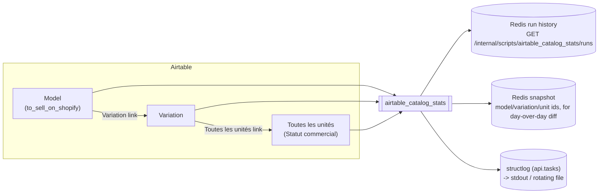

# Airtable Catalog Stats

| | |
| --- | --- |
| **Module** | `api.scripts.airtable_catalog_stats` |
| **Schedule** | daily at `AIRTABLE_CATALOG_STATS_HOUR`:`AIRTABLE_CATALOG_STATS_MINUTE` (default `20:42`, `Europe/Paris`) -- also runnable on demand |
| **Reads** | Airtable (Model, Variation, Toutes les unités) only -- no Shopify calls |
| **Writes** | nothing -- strictly read-only |
| **Requires** | `AIRTABLE_BASE_ID` + `AIRTABLE_TOKEN` (otherwise the run is recorded as `skipped`) |

## What it does

A broad, Shopify-independent scrape of the whole catalog: how big it is, how it's
shaped (variants per model, units per variant), a couple of catalog-hygiene signals,
and how all of that is changing day over day. Where
[`shopify_catalog_reconciliation`](shopify_catalog_reconciliation.md) asks "does
Shopify match Airtable for the things we sell online", this script doesn't compare
against Shopify at all -- it's purely about the catalog's own shape and growth, useful
for spotting things like data-entry gaps (a Model nobody ever added a Variation to) or
just tracking how fast the catalog is growing.

## Data it fetches

## How it works

1. Fetch every Model, Variation, and Unit from Airtable (`api.domain.catalog`, the same
   module `shopify_catalog_reconciliation` uses).
2. Compute totals and derived ratios directly from those three lists -- no external
   calls beyond Airtable.
3. Diff the current full sets of Model/Variation/Unit ids against the previous run's
   snapshot (stored in Redis via `api.run_store.RunStore`, same pattern as
   `shopify_catalog_reconciliation`) to report how many of each were added since last
   time. The first run ever (no snapshot yet) reports 0 additions, not the whole catalog.

Live stages (`GET /internal/scripts/airtable_catalog_stats/current`):
`fetching_airtable_models`, `fetching_airtable_variations`, `fetching_airtable_units`,
`computing_statistics`.

## Metrics

`GET /internal/scripts/airtable_catalog_stats/runs` returns, per run:

| Metric | Meaning |
| --- | --- |
| `models_total` / `variations_total` / `units_total` | Raw catalog size |
| `avg_variations_per_model` | `variations_total / models_total` (0 if there are no models) |
| `avg_units_per_variation` | `units_total / variations_total` (0 if there are no variations) |
| `models_without_variations` | Catalog-hygiene signal: a Model with zero linked Variations |
| `variations_without_units` | Catalog-hygiene signal: a Variation with zero physical units |
| `models_to_sell_on_shopify` / `models_to_sell_on_shopify_pct` | How many/much of the catalog is flagged for Shopify at all |
| `units_a_vendre_total` | Units currently marked `Statut commercial = "A vendre"`, any sales channel |
| `models_added_since_last_run` / `variations_added_since_last_run` / `units_added_since_last_run` | Catalog growth since the previous run |
| `succeeded` | Always `1` on a completed run |

This script has no `details` payload (`details` is `{}`) -- every result is a flat
number, so each run in `GET /internal/scripts/airtable_catalog_stats/runs` is just
`status`, the metrics above, `duration_seconds` and `finished_at`. `GET /metrics`
exposes them to Prometheus as
`rewake_api_script_metric{script="airtable_catalog_stats", ...}`.

## Where to look

- **Trigger/history:** `POST /internal/scripts/airtable_catalog_stats/run`, `GET
  /internal/scripts/status/{task_id}`, `GET
  /internal/scripts/airtable_catalog_stats/runs`, `GET
  /internal/scripts/airtable_catalog_stats/current` (live stage while running).
- **Schedule:** `api/celery_app.py`'s `beat_schedule`, driven by the `beat` service in
  `docker-compose.yml` (20:42 Europe/Paris, DST included).
- **Logs:** `structlog`, logger `api.tasks`.
- **Source:** `api/scripts/airtable_catalog_stats.py`, `api/domain/catalog.py`.
- **Tests:** `tests/test_airtable_catalog_stats.py`.
