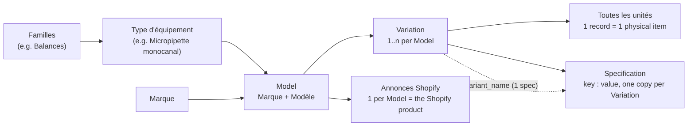
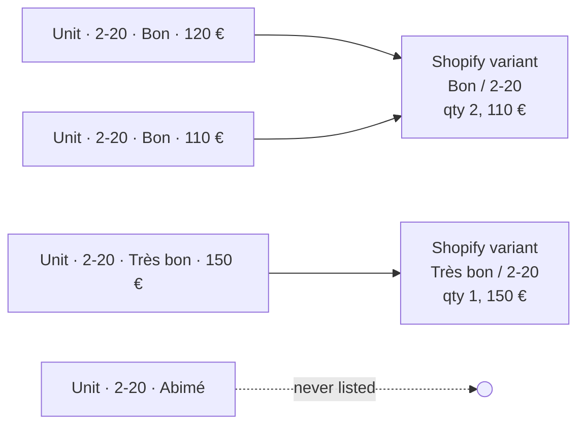
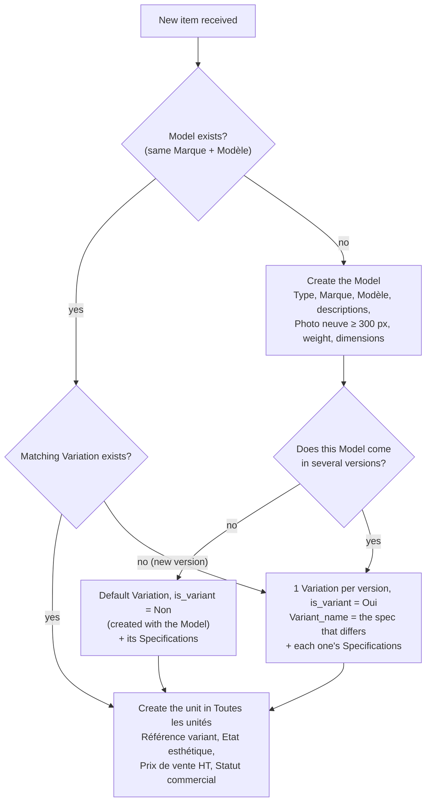

# Catalog model: Model, Variation, Unit

How a product is represented in Airtable, how the tables are linked, how that
becomes a Shopify listing, and what to create when a product we've never had
arrives. The figures come from the production base on 2026-10-02. How the
receiving app creates and reviews these records through `/internal/catalog`
is in [Catalog intake](catalog_intake.md).

## The chain

| Table | One record is | Holds | Linked by |
|---|---|---|---|
| **Model** | A commercial reference: brand + model name (`Name` = Type + Marque + Modèle) | Descriptions, `Photo neuve`, weight, dimensions, `Prix neuf HT`, `Documentation`/`Manuel Operateur`/`Manuel de service`, `to_sell_on_shopify`, `Vérification pour site` | `Type`, `Marque`, `Variation`, `Annonces Shopify` |
| **Variation** | One sellable version of a Model, e.g. a volume range of a micropipette | `is_variant`, `Variant_name`/`Variant_value`, `Specifications`, `Statut validation Variation` (`À valider`/`Validé`), `Statut verification` | `Model` (exactly one), `Toutes les unités` |
| **Toutes les unités** | One physical item in stock, with its own serial number | `Numéro de série`, `Etat esthétique`, `État fonctionnel`, `Statut commercial`, `Prix de vente HT`, `Prix de rachat`, `Photos marketplace`, `Photos client`, `Photos interne`, `Lieu de stockage` | `Référence variant` → one Variation; `Opération reprise` |
| **Specification** | One `clé : valeur unité` line (e.g. `Portée max : 220 g`) | `clé` (→ Specification type), `valeur`, `unité` | `Variation associée` (as a spec), `Spec_variant` (as the variant axis) |
| **Annonces Shopify** | The Shopify product for a Model | `ID_shopify`, `Status` (draft/active/archived/unlisted) | `Model` |

A unit has no direct link to its Model: it reaches it through its Variation.
The Model fields shown on a unit are lookups.

## What a Variation means

A Variation answers the question "which version of this Model is this unit?".
There are two cases:

- **The Model comes in several versions** (`is_variant = Oui`). There is one
  Variation per version, and each points to one Specification through
  `Variant_name` (its `valeur` becomes `Variant_value`, e.g. `2 - 20`). Example:
  *Finnpipette F1 | 2 - 20*, *Finnpipette F1 | 10 - 100*. The Variation's
  `Name` gets ` | <value>` appended.
- **The Model has only one version** (`is_variant = Non`). There is still exactly
  one Variation, a "default" one with no `Variant_name`, because units can only
  attach to a Variation. It is created automatically with the Model:
  `POST /internal/model/create` (the intranet's *Création de modèle*) creates
  the Model, then its `is_variant = Non` Variation. The receiving app's group
  push (`POST /internal/catalog/groups/push`) also creates the Model with its
  Variation(s), as drafts (`Statut validation Variation = À valider`).

The **condition is not a Variation.** `Etat esthétique` (Neuf, Neuf déclassé,
Très bon, Bon, Abimé, Très abimé) is stored on each unit, because two items of
the same version can be in different states.

| Today (production) | |
|---|---|
| Models | 1,786 (1,445 `to_sell_on_shopify = Oui`, 296 with a Shopify listing) |
| Models with exactly 1 Variation | 1,685 (94%) |
| Models with 2 to 22 Variations | 99 |
| Variations `is_variant = Non` / `Oui` / empty | 1,633 / 547 / 3 |
| Units | 3,905 (1,411 *A vendre*, 2,131 *Vendu*) |
| Specifications | 8,106, all but 3 linked to a single Variation |

## How it becomes a Shopify product

`create_product_shopify` and `update_product` build it the same way:

- **Shopify product** = the Model (title, descriptions, photos, vendor = Marque,
  product type = Type). Its Shopify id is stored in Annonces Shopify.
- **Shopify options**: `État esthétique` always. A second option is added only
  if a Variation has a `Variant_value`, and its label is hard-coded from the
  Type: "Plage de volume [µL]" for micropipettes, "Dimensions [cm]" for
  paillasses, "Variante" for anything else.
- **Shopify variant** = one per *(Variant_value, Etat esthétique)* pair found
  among the sellable units. Sellable means `Statut commercial = A vendre` and a
  condition other than Abimé/Très abimé.
  - **Quantity** = the number of those units.
  - **Price** = the lowest `Prix de vente HT` among them.
- **Spec table** (`main_table` metafield) = weight, dimensions, and the
  Specifications of the **first** Variation only, minus its variant spec.

So **stock and price come from units, structure comes from Variations, and
content comes from the Model.**

## Creating a product we've never had

The `create-rewake-model` skill automates the Model + Variation +
Specifications part. In the receiving workflow, the app does it through
`/internal/catalog`: operations push the group (a variant Variation gets its
axis spec through `Spec_variant`), and the commercial team reviews the Model
(`Vérification pour site`) before it is sold; see
[Catalog intake](catalog_intake.md).

Rules that the scripts rely on:

1. **Every unit needs exactly one Variation** (`Référence variant`). A unit
   without one is invisible to Shopify and to the reconciliation (52 such
   units today, plus 1 linked to two Variations).
2. **Every Variation needs exactly one Model** (5 have none today).
3. **A Model is either all `Non` (one Variation) or all `Oui`.** Never mix them:
   a `Non` Variation next to `Oui` ones would end up as a Shopify variant whose
   option value is `0`. No Model mixes them today.
4. **`is_variant = Oui` needs a `Variant_name`.** 5 Variations break this today,
   and 3 have `is_variant` empty. The intake push refuses a variant without
   its axis (`missing_variant_axis`).
5. **Only one dimension can vary.** `Variant_name` holds a single spec, so a
   pipette range can be a variant axis, but "range × number of channels" can't.
   Make those separate Models.
6. **Specs that differ between versions, other than the variant axis, are
   lost on Shopify.** Only the first Variation's specs go into the spec table.

## The weak spots

- **The default Variation duplicates the Model.** For 94% of Models it's a copy
  of the Model that exists only so units have something to link to. It's created
  automatically, so it costs no work, but it's still a second record per
  product, and it's where the Model's specs end up (see the next point).
- **Specs are copied for every Variation.** A 10-version pipette has 10 copies
  of "Nombre de canaux : 1", which have to be kept consistent by hand. Only the
  first copy is used.
- **`is_variant` is typed by hand** (the API only sets it on the records it
  creates or converts) but can be worked out from the data (`Variant_name`
  filled or not), so it drifts (8 inconsistent records).
- **The second option's label is hard-coded** by Type name in the code
  (`_variant_option_name` in `api/scripts/_shopify_links.py`), so a new Type
  with versions just gets "Variante".
- **Prices live in two places.** Each unit has its own `Prix de vente HT` (what
  Shopify uses), and the Variation also has `Prix bon état €HT`, `Prix abimé €HT`
  and `Prix de la variation`, which nothing in the API reads.

## Suggested improvements

They are ordered from cheapest to most structural. Each one can be done on its
own, without changing what Shopify shows.

1. **Make `is_variant` a formula:** `IF({Variant_name}, "Oui", "Non")`. The code
   only compares it to `"Oui"`, so nothing breaks, and the 8 inconsistent
   records disappear.
2. **Add data-quality views,** and have the reconciliation flag the same cases:
   units without a Variation, Variations without a Model, Models that mix `Oui`
   and `Non`.
3. **Move the variant label to the Type:** add an "Axe de variante" field on
   Type d'équipement (e.g. "Plage de volume [µL]") and read it instead of the
   hard-coded names.
4. **Put common specs on the Model:** link Specification to Model for what all
   versions share, and keep on each Variation only the spec that defines it
   (`Variant_name`). This removes the copies (most of the 8,106 records) and the
   "first Variation only" rule, and the spec table reads Model specs + the
   variant value.
5. **Keep the default Variation.** It's already created automatically, so the
   duplication costs no work; what it still costs is the specs stored on it,
   which suggestion 4 moves to the Model. Removing the level altogether (units
   linking straight to a Model) would mean two different ways for a unit to
   find its Model and two code paths in every script, so a Variation that
   always exists is the simpler rule: **Model → ≥1 Variation → units**, always.
6. **Choose one source of truth for price:** either the unit's
   `Prix de vente HT` (today's behaviour), with the Variation prices removed or
   turned into suggestions, or a price per (Variation, condition) that is
   copied onto new units.

The condition stays on the unit. It describes one physical item, and the
current mapping to Shopify (condition = an option, units = quantity) is right.
