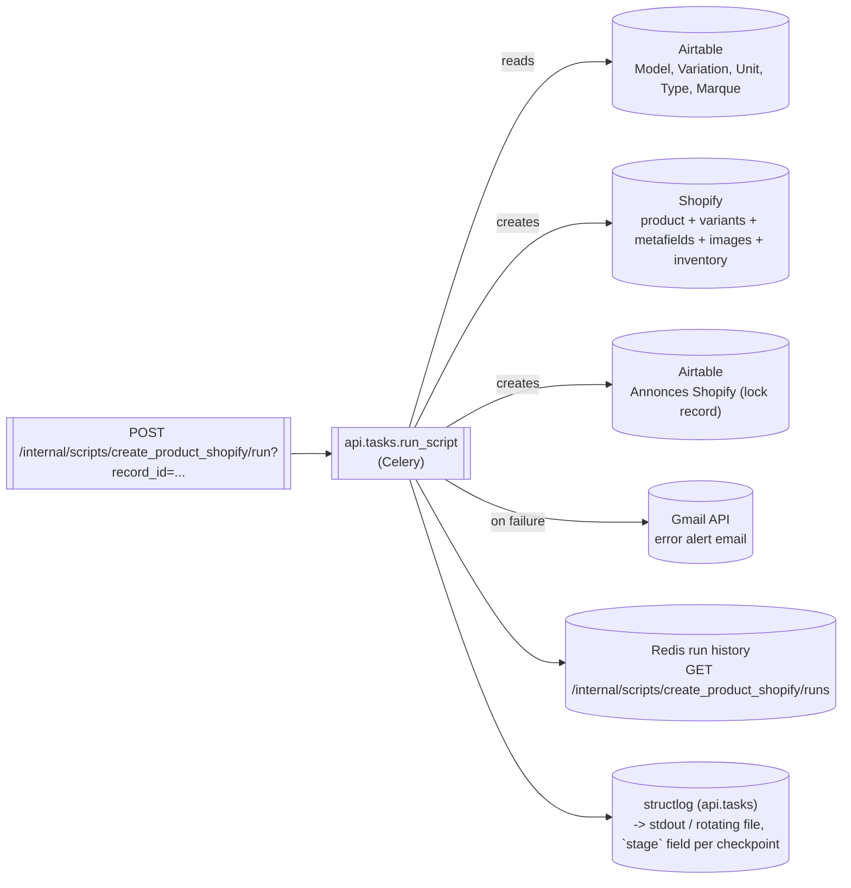

# Create Product Shopify

 

| | |
| --- | --- |
| **Module** | `api.scripts.create_product_shopify` |
| **Schedule** | on-demand only (`schedule = None`) -- requires a `record_id` (an Airtable **Model** id) |
| **Reads** | Airtable (Model, Variation, Toutes les unités, Type d'équipement, Marque, Familles, Specification) |
| **Writes** | **Shopify** (creates a new product, variants, metafields, images, documentation PDF, inventory) + Airtable (`Annonces Shopify`, and `Date de mise en ligne` on units) |
| **Requires** | Airtable + Shopify settings and `SHOPIFY_LOCATION_ID`, otherwise the run is recorded as `skipped` |
| **Origin** | ported from a Google Cloud Function (`create_product_shopify(request)`, a Flask handler); this port is new code written in-process for this API |

## What it does

Creates a brand-new Shopify product listing from an Airtable Model that doesn't have
one yet: validates the Model's data is complete enough to list (descriptions, weight,
a usable photo, sellable units with a valid price), builds one Shopify variant per
(size/range, état esthétique) combination found among its sellable units, sets generic
and family-specific metafields, uploads product images, and pushes inventory levels --
then records the new listing back into Airtable (`Annonces Shopify`) so it isn't
created twice.

This is the **only script here besides `update_product`** that writes to Shopify, and
the only one of the two that *creates* a listing rather than updating an existing one.
Both are native Python in this repo -- there's no external process involved.

## Documentation PDF

Shared with `update_product` via `api/scripts/_product_documentation.py` (upload through
`api/integrations/shopify_files.py`, GraphQL).

- **Source:** the Model's Airtable `Documentation` attachment field -- the first attachment
  that is a PDF (MIME type, or a `.pdf` filename). Other attachments are ignored.
- **Target:** the product metafield `SHOPIFY_PDF_METAFIELD_NAMESPACE`.`SHOPIFY_PDF_METAFIELD_KEY`
  (default `custom.pdf_descriptif`, the "PDF Descriptif" definition), type `file_reference`,
  plus a companion `single_line_text_field` (`custom.pdf_descriptif_airtable_id` by default)
  recording the Airtable attachment id the Shopify file came from.
- **Upload:** the PDF is downloaded from Airtable (signed url, fetched fresh with the
  record) and sent through Shopify's staged upload -> `fileCreate` -> poll until
  `READY` -> `metafieldsSet` (both metafields in one atomic call).
- **Change detection:** a product this script just created has no PDF yet, so the
  upload always happens when Airtable has one (no Shopify read first). Later changes are
  `update_product`'s job (see its own "Documentation PDF" section).
- **Size limit:** a PDF over Shopify's 20 MB limit is first compressed with Ghostscript
  (`api/utils/pdf_compression.py`); if it's still too big, the sync fails with both
  sizes in the message (the Airtable original is never modified).
- **Never clears:** an empty Airtable field writes nothing (`documentation_status:
  "absent"`) -- there's no deletion-sync convention in this project.
- The replaced Shopify file is not deleted from the Files library (it may be referenced
  elsewhere).
- **Scopes:** the Shopify app needs `write_files` and `read_files` (confirmed missing on
  the RewakeDev token on 2026-09-28 -- `fileCreate` answers ACCESS_DENIED without them).
- **Failure handling:** attached last, after variants, so a creation rolled back earlier
  never leaves an orphan file. It's optional content: no PDF -> nothing happens. A PDF
  that can't be uploaded sends an alert email and is reported in `details`, but the
  product is kept and the run is still a `success`. Reconciliation then lists it under
  "Documentation PDF absente de Shopify", and its bulk action retries it.

## Idempotence (two layers)

1. **Before anything else**, verify directly against Shopify (not just Airtable) that no
   listing already exists for this Model. Airtable's own record of "does this have a
   Shopify id" can be stale (a previous attempt could have failed after linking but
   before actually creating the product, or vice versa), so this always makes a real
   Shopify API call rather than trusting Airtable alone.
2. **Immediately after** the Shopify product is created -- before metafields, images, or
   variants -- an `Annonces Shopify` Airtable record is created linking back to the
   Model. This is a retry-safe lock: Airtable auto-maintains the reverse link, so if this
   run (or Cloud Tasks-style retry, in the original) is re-triggered, layer 1's check
   finds this record and stops before creating a second product. **This ordering is
   deliberate -- don't move the lock-record creation later "for cleanliness."**

Neither of those two layers, on their own, stops two truly *concurrent* triggers for the
same Model from both passing layer 1's check before either has created anything --
that's a real race, present in the original Cloud Function too, not introduced by this
port. It's closed by a third mechanism, one level up: `api/tasks.py`'s `run_script`
takes a Redis lock (`RunStore.acquire_lock`) keyed by `record_id` before calling this
script's `run()` at all, and records an immediate `skipped` result for a second
concurrent trigger rather than letting it race. See `docs/architecture.rst`'s
`api/tasks.py` section for the full explanation -- verified live: two simultaneous
triggers for the same record, one rejected in 5ms, the other ran normally to completion.

### Safeguards added after the 2026-10-05 incident

An Airtable automation re-triggered this script about every 40 s for one Model and
left duplicate products on Shopify. Three causes, three fixes:

1. **Create and update collided.** The lock record this script writes changes the
   Model, which fired an `update_product` on the product still being created. Shopify
   then answered both with `409 "This product is currently being modified"`, and the
   image uploads failed. Both scripts now share one Redis lock per Model
   (`SHOPIFY_MODEL_LOCK_NAME` = `"update_product_model"` in
   `api/scripts/_shopify_links.py`). Whichever starts second raises `RequeueLater` and
   is put back on the queue until the first finishes.
2. **The rollback dropped the lock while the product was still on Shopify.** When the
   product's deletion failed (e.g. 409), `_cleanup_failed_creation` deleted the
   Annonces Shopify record anyway, so the next trigger created another copy. It now
   keeps the record when the product isn't really gone (the next trigger then sees the
   product and stops), and reports `cleanup_error`. A creation whose lock record can't
   be written is rolled back right away.
3. **Rollbacks re-fired the automation.** A rolled-back run is recorded with
   `rolled_back: true` (a run that crashed in a post-creation stage counts too, via
   `failed_at_stage`). For `ROLLBACK_COOLDOWN_SECONDS` (15 min) afterwards, triggers
   for that Model are recorded with `status: "skipped"`, the reason and the remaining
   wait in `skipped_reason`. Only the latest run for the Model counts. This applies
   to the dashboard button too. Runs that failed before creating anything (plain
   validation errors) never start a cooldown.

## Data it touches



## Triggering from Airtable

An Airtable automation ("Run script" action, input `model_id` = the Model's
record id) calls the API directly with `AIRTABLE_AUTOMATION_TOKEN` -- it
replaces the former queue manager -> Cloud Tasks -> Cloud Function chain
(Celery is the queue now, with its own retries and per-`record_id` lock):

```js
let inputConfig = input.config();
let model_id = inputConfig.model_id[0];
if (!model_id) throw new Error("Model ID manquant");

// Airtable automation secret, same value as the API's AIRTABLE_AUTOMATION_TOKEN
let token = input.secret("AIRTABLE_AUTOMATION_TOKEN");

let response = await fetch(
  `https://api.rewake.fr/internal/scripts/create_product_shopify/run?record_id=${encodeURIComponent(model_id)}`,
  { method: "POST", headers: { Authorization: `Bearer ${token}` } }
);
if (!response.ok) {
  throw new Error(`Erreur API: ${response.status} - ${await response.text()}`);
}
let result = await response.json();
console.log("✅ Tâche ajoutée:", result.task_id, result.status);
```

The response only confirms the run was queued; its outcome is in
`GET /internal/scripts/create_product_shopify/runs` (and the alert email on
failure). See [Authentification](./authentication.md) for the token's scope.

## How it works

1. `POST /internal/scripts/create_product_shopify/run?record_id=recXXXXXXXXXXXXXX`
   queues a Celery task; a missing `record_id` is rejected with `400` (same query param
   `update_product` uses -- both take a `record_id`, they're just for different tables:
   `update_product`'s is a Variation id, this one's is a Model id).
2. Reports a `report_stage` checkpoint at each major step (`checking_existing_listing`,
   `validating_model`, `resolving_type_and_marque`, `creating_shopify_product`,
   `creating_airtable_lock_record`, `building_metafields`, `uploading_images`,
   `creating_variants`, `uploading_documentation`, `updating_unit_listing_dates`) -- visible live via
   `GET /internal/scripts/create_product_shopify/current` while it runs, and in
   Grafana/Loki (`script="create_product_shopify"`, `stage="..."`).
3. Existence check, then ~15 individual field validations (each raises an internal-only
   `_ValidationFailed`, caught once and turned into a `ScriptResult` failure -- see
   `api/scripts/create_product_shopify.py`'s module docstring for why this shape was
   chosen over either a bare early-return chain or a full custom exception hierarchy).
   Among them: `Short description`, `Long description`, a positive `Poids net (kg)`,
   `Name` and `Type`, at least one `Photo neuve` (every one at least 300x300px); every
   unit linked to the Model's Variations needs a non-empty `Prix de vente HT`; every
   "A vendre" unit needs a sale price not below its `Prix de rachat`, and, when it's
   sellable (not Abimé/Très abimé), a `Prix de vente HT` above 0. A unit at 0, empty or
   invalid fails the run before anything is created on Shopify, with a link to that
   unit. No sellable unit at all is a failure too.
4. Creates the Shopify product (shell, no variants yet), then the Airtable lock record.
5. Builds the metafields: a generic spec table (weight, dimensions, any non-variant
   Specification whose name is `"key : value"`-shaped) plus family-specific "filter"
   metafields (currently only defined for the `"Balances"` family -- see
   `FAMILY_FILTER_METAFIELDS` in the source).
6. Uploads product images one at a time: "Photo neuve" always, plus
   marketplace photos from the *first* sellable unit that has any (see "Known risks"
   below for the exact semantics here).
7. Groups sellable units into variant rows by `(variant value, état esthétique)`,
   aggregating to `(min price, count)` per group; creates one Shopify variant per row
   (the first is bundled into the product-level update that also sets Shopify's
   `options`, matching Shopify's own requirement that a product have at least one
   variant before more can be added), and pushes each variant's inventory level.
   Options: "État esthétique", plus a second option holding the Variation's
   `Variant_value` whenever any of the Model's Variations has one
   (`_model_has_variant_values`).
8. Attaches the documentation PDF (see "Documentation PDF").
9. Updates `Date de mise en ligne` on every unit that was just listed, if not already set.
10. Sends an error-alert email (`api.services.gmail.send_alert_email`, reusing the
    existing Google service account -- no separate SMTP credential) on any failure, on
    a failed documentation upload, and when a family filter spec is missing.

## Deliberate deviations from the source Cloud Function

- **No pandas/numpy.** The source used pandas only for a small groupby-aggregate and
  numpy only for incrementally building small 2D arrays; this port uses a plain
  `collections.defaultdict` instead (see `_build_variant_rows`). Behaviorally
  equivalent, including `sorted()` on the groups to match pandas' `groupby(sort=True)`
  default -- this matters because the *first* variant row is special-cased (bundled
  into the options-setting product update), so group iteration order isn't cosmetic.
- **No SMTP / hardcoded credential.** The source had a Gmail app-password hardcoded in
  plaintext. This port instead reuses the Gmail API service account already configured
  for `api.services.gmail.create_draft` (`GOOGLE_APPLICATION_CREDENTIALS`), sending
  (not drafting) from `ALERT_EMAIL_SENDER` to `ALERT_EMAIL_RECIPIENTS`. No new
  credential type, and nothing plaintext.
- **Hardened: zero-variants-created is now a failure, not a silent success.** The
  source logs each variant/metafield creation failure and continues regardless --
  if *every* variant call failed (e.g. a bad payload, a Shopify API change), it still
  returned success with a real product that has zero real variants. This port checks
  the count of variants actually created and fails the run (with cleanup: the Shopify
  product and Airtable lock record are both deleted) if it's zero. Metafield failures
  are still soft/non-fatal, same as source -- only "the product is fundamentally
  unsellable" is hardened.
- **`SHOPIFY_LOCATION_ID` is now required config**, not a hardcoded production value.
  Confirmed empirically the dev store has three locations, none matching the
  production id the source hardcoded (`84104446276`) -- see `.env.example`.

## Known risks / things worth reviewing

This is a large, first-time port of real, previously-production business logic, tested
so far with unit tests (hand-written fakes) and one real end-to-end run against the
dev store (see below) -- not exhaustively exercised against every historical edge case
the source handled. Worth a closer look before relying on this for real production
listings:

- **Marketplace-photo semantics, preserved exactly (possibly surprising).** Only the
  *first* unit (in Airtable's own order) with any raw `Photos marketplace` entries at
  all contributes photos -- even if every one of its photos gets filtered out by the
  ≥300×300px/dedup-against-"Photo neuve" checks, the function does not keep looking at
  later units for one that actually has a usable photo. If a Model's first-listed unit
  happens to have only low-res marketplace photos, the listing gets **zero** marketplace
  photos even though a later unit might have great ones. This is the source's exact
  behavior, kept deliberately rather than "fixed" -- confirm this is actually wanted.
- **Metafield creation failures are silent.** Unlike the hardened variant-count check
  above, a generic metafield that fails to create is at most logged (the response
  status isn't even checked), never surfaces in the run's result at all. A product
  could ship with a missing `main_table` and the run would still report success. For
  family filter metafields, a spec Airtable doesn't have (or a network error) sends an
  alert email listing the missing ones, but the run still succeeds.
- ~~Fixed, but worth knowing about: the second Shopify option was decided by a
  hardcoded Type-name lookup, not by whether the Model actually needed one.~~
  `_resolve_option` used to return `None` (no second option at all) for any Type
  outside two hardcoded special cases (`Micropipette`, `Paillasse`/`Meuble sous
  paillasse`) -- confirmed live: a genuinely multi-variant Model (two distinct sizes)
  whose Type was neither of those got created with **only one Shopify option**. Now
  detected from whether *any* of the Model's Variations has a non-empty
  `Variant_value`, with or without stock (`_model_has_variant_values`); the Type name
  still only picks a nicer option label for the two known families, falling back to a
  generic `"Variante"` otherwise. A product created before this fix with only one
  option is repaired by its next `update_product` run, which decides the options from
  Airtable and recreates the variants under them (see `docs/update_product.md`).
- **`SHOPIFY_API_VERSION` is `2025-01`** (this project's existing shared default),
  **not** `2025-07` (what the source was actually written and validated against). No
  equivalence check has been done between these two versions for the specific mutating
  endpoints this script uses (product/variant/metafield/image/inventory writes) --
  worth a deliberate check, not an assumption, before trusting this in production.
- **Family-specific filter metafields only cover `"Balances"`** (ported as-is from the
  source's own `METAFIELDS` dict) -- every other family gets only the generic spec
  table, no dedicated filter metafields. If other families need filters, that mapping
  needs extending; nothing in this port adds new families beyond what the source had.
- **The three-repo naming quirk in `Model.fields["Status (from Annonces Shopify (dev))"]`
  is real, not a typo** -- copied byte-for-byte from the source. It's a rollup field
  whose own name happens to contain `"(dev)"` even when read against the production
  base. If this field is ever renamed in Airtable, this string must be updated to match
  exactly, or the "already has an active listing" short-circuit silently stops working
  (falls through to always re-checking Shopify directly, which is safe but slower --
  not a silent-corruption risk, just worth knowing this specific string is load-bearing).
- ~~No dedicated unit test for the "network error on the initial product-creation POST"
  path~~ -- covered by `tests/test_shopify_rest.py`, added alongside the 409 fix below.
- **Concurrent image uploads to the same product can 409 -- now uploaded one at a
  time** (`IMAGE_UPLOAD_WORKERS = 1` since 2026-10-05: the retries below still let 1
  image in 7 fail in production, which rolled the whole creation back). They used to
  upload in parallel to *one* product; Shopify's Admin API
  rejects a same-product write that collides with another one in flight with `409
  {"errors": {"product": ["This product is currently being modified. Please try again
  later."]}}` -- confirmed live against the dev store (7 concurrent image uploads via
  `ThreadPoolExecutor(max_workers=3)` reliably produced at least one 409). Unlike a
  network error or 5xx, this isn't ambiguous about whether the write applied -- Shopify
  says outright it didn't -- so `ShopifyAdmin._request` now retries a 409 with backoff
  regardless of HTTP method. See `tests/test_shopify_rest.py` for the retry-matrix
  coverage.

## Metrics and details

`GET /internal/scripts/create_product_shopify/runs` returns, per run:

| Key | Meaning |
| --- | --- |
| `metrics.variants_created` | How many Shopify variants were actually created (0 forces failure -- see "Deliberate deviations" above) |
| `metrics.images_uploaded` | How many images were successfully uploaded |
| `metrics.documentation_uploaded` | 1 when the documentation PDF was attached, else 0 |
| `details.documentation_status` | `uploaded` / `absent` (no PDF in Airtable) / `failed` (product kept -- see "Documentation PDF") |
| `details.documentation_error` | Present when `documentation_status` is `failed` |
| `details.model_id` | The Model record this run was for |
| `details.shopify_product_id` / `details.shopify_product_url` / `details.airtable_listing_url` | The created (or, on a skip/"already exists" failure, the existing) Shopify product and its Annonces Shopify record |
| `details.documentation_file_id` | The Shopify file id, when `documentation_status` is `uploaded` |
| `details.documentation_compressed` / `details.documentation_original_size` / `details.documentation_uploaded_size` | Present when the PDF had to be compressed to fit Shopify's 20 MB limit |
| `details.title` | The Model's name, for quick scanning in the run history -- present on **every** outcome (success, skip, or `_ValidationFailed`), not just success: it defaults to `"Produit inconnu"` at the top of `run()` and is filled in from the Model record (or, for the existence-check skip, from `_check_existing_listing`'s own cached fetch) as soon as it's known. |
| `details.skipped_reason` | Present (with `status: "success"`) when an existing-listing guard stopped the run before creating anything -- not a failure; with `status: "skipped"` during the rollback cooldown |
| `details.error` | Present on failure: the validation message or the unexpected exception |
| `details.rolled_back` / `details.cleanup_error` | `rolled_back: true` when the created product was rolled back; `cleanup_error` when the Shopify product couldn't be deleted (its Annonces Shopify record is then kept) |
| `details.failed_at_stage` | Present on an unexpected exception (recorded by `api/tasks.py`) |
| `details.airtable_model_url` | Present on every `_ValidationFailed` -- a link to the Model record the failing check is about, even for a Model-level check with no more specific link (e.g. a missing description) |
| `details.airtable_unit_url` / `details.airtable_variation_url` / `details.airtable_type_url` | Present when the specific failing check is scoped to a Unit, Variation, or Type record rather than the Model as a whole (e.g. a per-unit sale-price-vs-buyback-price check) -- lets a human jump straight to the *actual* record that's wrong, not just the Model it belongs to |

## Where to look

- **Trigger/history:** `POST /internal/scripts/create_product_shopify/run?record_id=recXXX`,
  `GET /internal/scripts/status/{task_id}`, `GET
  /internal/scripts/create_product_shopify/runs`, `GET
  /internal/scripts/create_product_shopify/current` (live stage while running).
- **Logs:** `structlog`, logger `api.scripts.create_product_shopify` (business logic) and
  `api.tasks` (stage/lifecycle events) -- stdout, the rotating file, and Grafana/Loki
  (`script="create_product_shopify"`).
- **Error alerts:** email, via `api.services.gmail.send_alert_email` --
  `ALERT_EMAIL_SENDER`/`ALERT_EMAIL_RECIPIENTS` in `.env`.
- **Source:** `api/scripts/create_product_shopify.py`, `api/integrations/shopify_rest.py`
  (the Shopify Admin REST client, mutation-focused -- distinct from
  `api/integrations/shopify.py`'s read-only GraphQL client used by
  `shopify_catalog_reconciliation`).
- **Tests:** `tests/test_create_product_shopify.py`, `tests/test_shopify_rest.py`,
  `tests/test_product_documentation.py`.
