# Manuel — Réception produits

> - **Pour qui ?** L'équipe opérations, et toute personne qui réceptionne des
>   appareils de reprise.
> - **Durée moyenne par produit :** 2 à 5 minutes.
> - **Ce qu'il vous faut :** un téléphone ou une tablette, un mètre, l'accès
>   « Réception produits » sur l'intranet.

Les images grises sont provisoires (numéro et contenu attendu). Les captures
marquées « ancienne interface » montrent la version précédente des écrans :
le texte du manuel fait foi. Voir la
[liste des images à fournir](./reception-produits-images.md).

---

## Le principe en une image

On réceptionne **un produit à la fois**, toujours dans le même ordre, puis on
passe au suivant :

```
 📷 Photos → 🔢 N° de série → 🏷️ Marque et modèle → 📏 Mesures → 📋 État → ✅ Produit complet
                                                                              │
                     ┌──────────────────────── produit suivant ◄──────────────┘
```

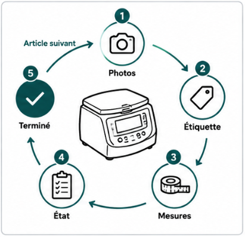
*🖼️ Image 0 — Schéma : les 5 étapes d'un produit en boucle (photos, n° de
série, marque et modèle, mesures, état), puis « Produit complet » → produit
suivant.*

Chaque **produit complet part tout seul dans Airtable** (son unité, avec
toutes ses photos). À la fin, on touche **Terminer la réception** : c'est
fini, il n'y a pas d'autre étape.

---

## Sommaire

1. [Avant de commencer](#1-avant-de-commencer)
2. [Ouvrir « Réception produits »](#2-ouvrir--réception-produits-)
3. [L'accueil : trois onglets](#3-laccueil--trois-onglets)
4. [Commencer une nouvelle réception](#4-commencer-une-nouvelle-réception)
5. [Prendre les photos d'un produit (caméra)](#5-prendre-les-photos-dun-produit-caméra)
6. [Compléter le produit, étape par étape](#6-compléter-le-produit-étape-par-étape)
7. [Produit complet → produit suivant](#7-produit-complet--produit-suivant)
8. [Reprendre une réception plus tard](#8-reprendre-une-réception-plus-tard)
9. [La liste des produits de la réception](#9-la-liste-des-produits-de-la-réception)
10. [Terminer la réception](#10-terminer-la-réception)
11. [Astuces](#11-astuces)
12. [Problèmes fréquents](#12-problèmes-fréquents)
13. [Légende des icônes et couleurs](#13-légende-des-icônes-et-couleurs)

---

## 1. Avant de commencer

| ✅ | À vérifier |
|---|---|
| 🚚 | Dans Airtable, le **Statut logistique** de l'opération de reprise est **« Appareils reçus »** (voir [§ 4](#4-commencer-une-nouvelle-réception)). |
| 🔋 | Téléphone ou tablette chargé. |
| 🔒 | Adresse en **https** (sinon la caméra ne s'ouvre pas). |
| 📷 | Autoriser la caméra la première fois que le navigateur le demande. |
| 💡 | Un endroit bien éclairé, sans reflet direct sur les étiquettes. |
| 📏 | Un mètre à portée de main. |

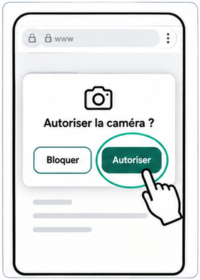
*🖼️ Image 1 — Capture de la fenêtre du navigateur « Autoriser l'accès à la
caméra ? » avec le bouton « Autoriser » entouré.*

---

## 2. Ouvrir « Réception produits »

1. Ouvrez l'intranet.
2. Touchez la tuile **📦 Réception produits**.

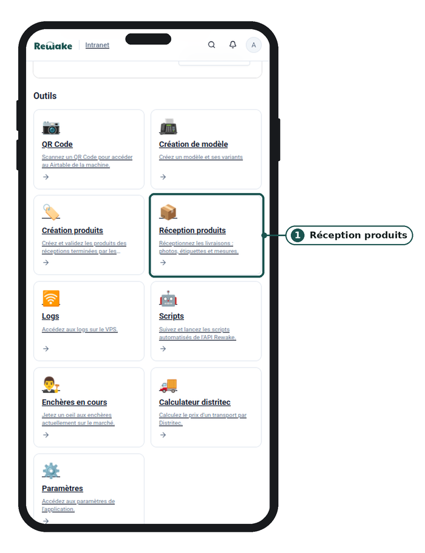
*Image 2 — ① Réception produits.*

> 💡 Dès que vous touchez un bouton, une **barre de chargement** apparaît en
> haut de l'écran (et « Chargement… » si cela prend plus d'un instant). Pas
> besoin de toucher deux fois.

---

## 3. L'accueil : trois onglets

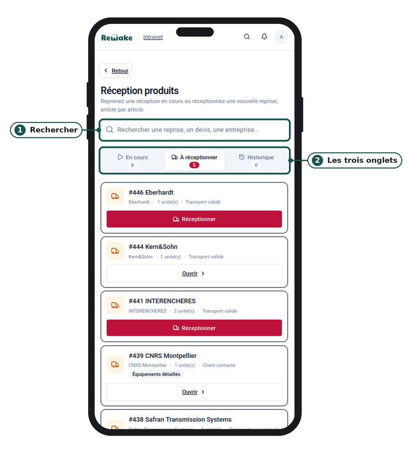
*Image 3 — ① Rechercher · ② Les trois onglets.*

| Onglet | Ce que vous y trouvez | Bouton |
|---|---|---|
| **▶ En cours** | Les réceptions ouvertes et pas terminées. | **Reprendre** (ou **Commencer** si rien n'est encore reçu) |
| **🚚 À réceptionner** | Les reprises dont le Statut logistique est **« Appareils reçus »** dans Airtable, pas encore réceptionnées ici. | **Réceptionner** (ou **Ouvrir**) |
| **🕓 Historique** | Les réceptions terminées ou annulées. | **Voir** |

- 🔎 La **barre de recherche** (« Rechercher une reprise, un devis, une
  entreprise… ») filtre les trois onglets à la fois. Le nombre de chaque
  onglet se met à jour.
- L'application **se souvient de l'onglet** que vous avez choisi.

---

## 4. Commencer une nouvelle réception

**Étape 0.** Quand le matériel arrive, dans Airtable, passez le **Statut
logistique** de l'opération de reprise à **« Appareils reçus »**. Sans ça, la
reprise n'apparaît pas dans l'application (une aide ⓘ le rappelle en bas de
la liste). Une reprise dont le Statut opérationnel est « Inventaire terminé »
n'apparaît pas non plus.

**Étape 1.** Onglet **🚚 À réceptionner** : trouvez la reprise (tapez le nom
ou l'entreprise dans la recherche).

**Étape 2.** Touchez **Réceptionner**.

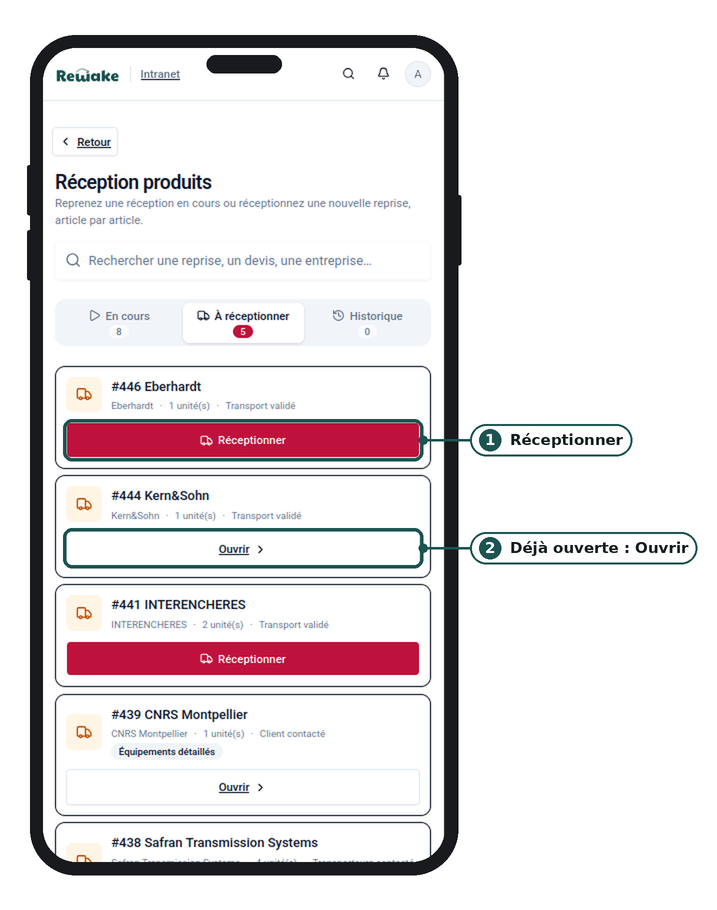
*Image 4 — ① Réceptionner · ② Déjà ouverte : Ouvrir.*

> ℹ️ Si une réception est déjà ouverte pour cette reprise, le bouton s'appelle
> **Ouvrir** : il vous y emmène, rien n'est créé en double.

**Étape 3.** La page de la réception s'ouvre : la **liste des produits**
attendus. Touchez un produit marqué **« À recevoir · touchez pour
photographier »** : la caméra s'ouvre. La première photo le compte comme
reçu.

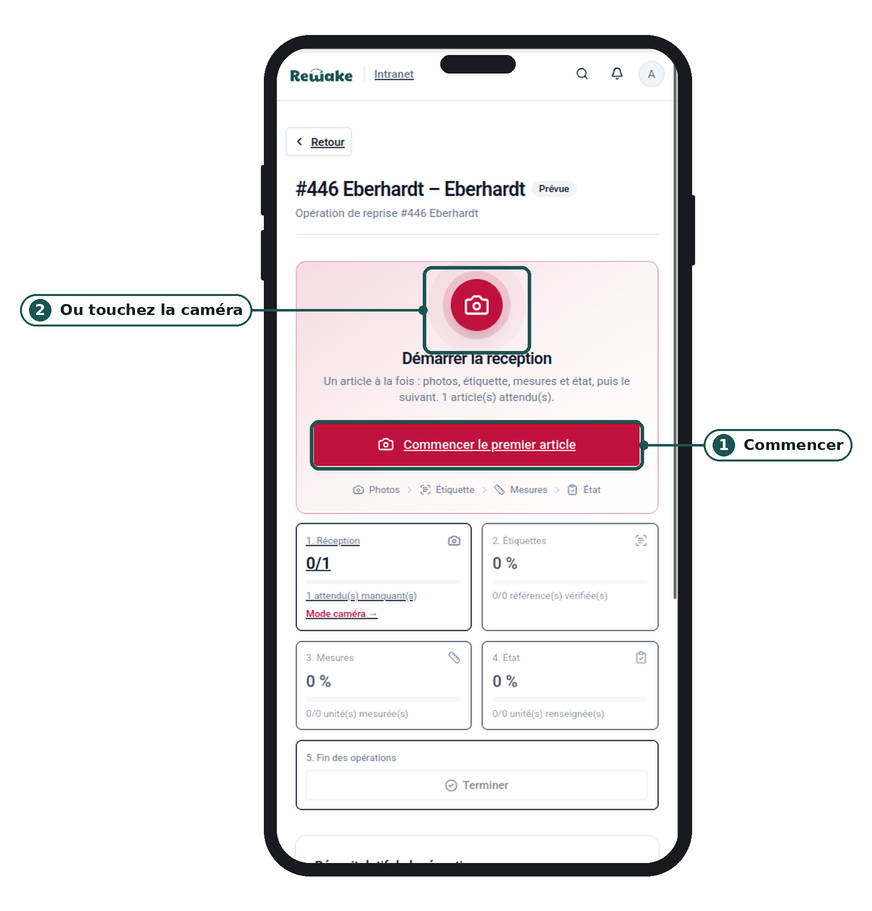
*Image 5 — ① Commencer · ② Ou touchez la caméra. (Ancienne interface : ce
bouton n'existe plus, touchez directement un produit de la liste.)*

---

## 5. Prendre les photos d'un produit (caméra)

La caméra s'ouvre en plein écran. En haut : le **nom du produit** attendu et
les **5 étapes** (vous pouvez en ouvrir une en la touchant). Touchez le nom du
produit pour voir ce que dit la reprise (photos du client, marque, modèle,
n° de série, état annoncé, dimensions…).

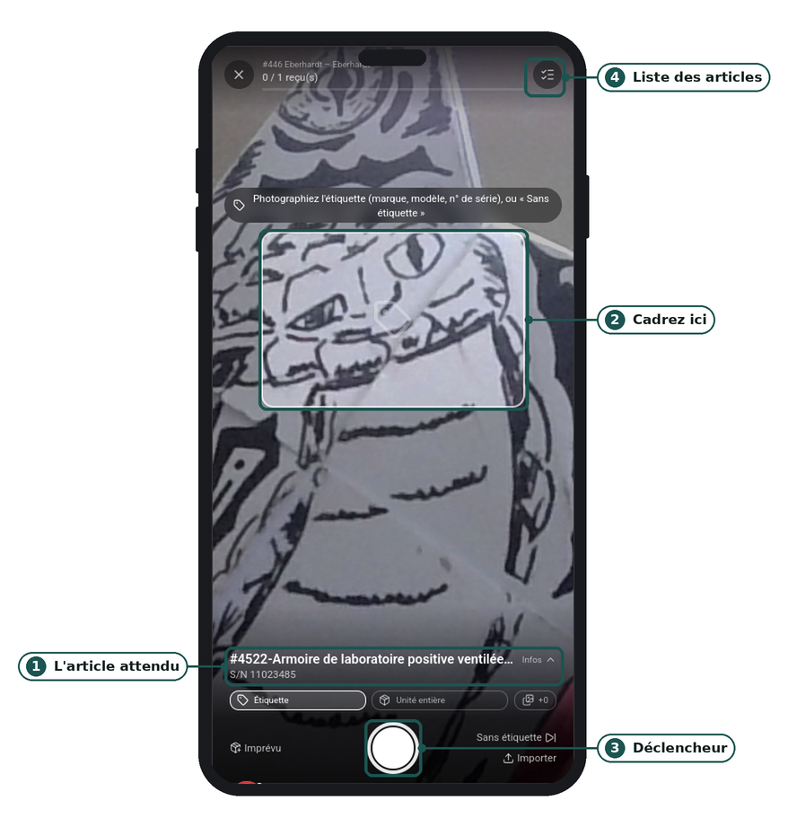
*Image 6 — ① L'article attendu · ② Cadrez ici · ③ Déclencheur · ④ Liste des
articles (ancienne interface : la liste n'est plus dans la caméra).*

### 5.1 Photo de l'étiquette 🏷️

1. Cadrez l'**étiquette** (plaque signalétique) dans le cadre rectangulaire.
2. Touchez le **déclencheur** (gros rond blanc).

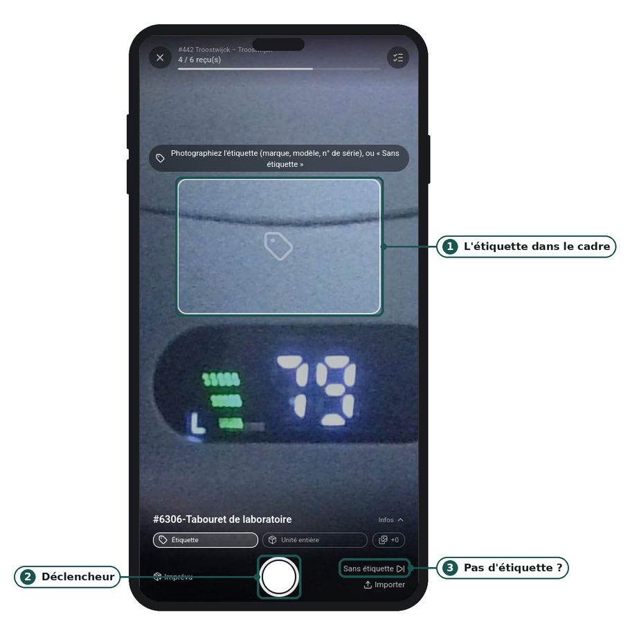
*Image 7 — ① L'étiquette dans le cadre · ② Déclencheur · ③ Pas d'étiquette ?. (Ancienne interface.)*

- Pas d'étiquette sur l'appareil ? Touchez **Sans étiquette ⏭**.
- La lecture de l'étiquette (marque, modèle, n° de série) se fait **toute
  seule en arrière-plan** : continuez sans attendre.

### 5.2 Photo du produit entier 📦

1. Reculez pour avoir **tout l'appareil** à l'écran.
2. Touchez le déclencheur.

Cette photo est **obligatoire** : sans elle, le bouton reste sur
« Photographiez le produit entier pour continuer ».

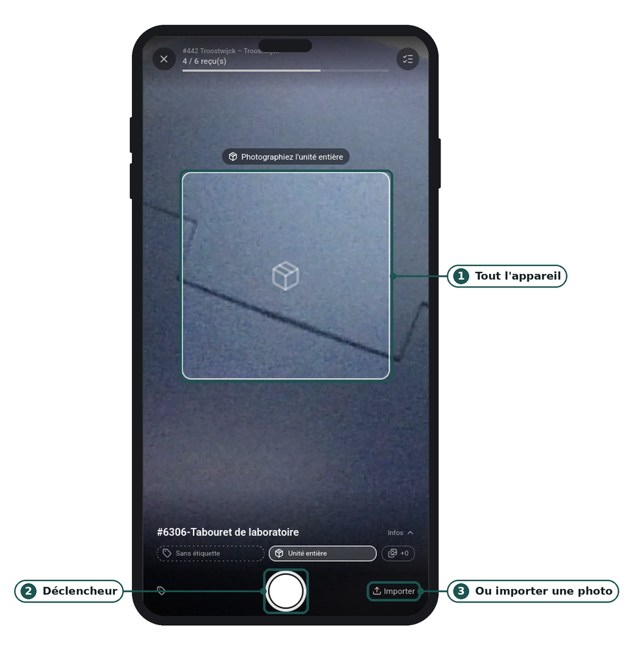
*Image 8 — ① Tout l'appareil · ② Déclencheur · ③ Ou importer une photo. (Ancienne interface.)*

### 5.3 Photos facultatives

Touchez **+N** : des pastilles apparaissent (**Branchement, Dessus, Face,
Côté gauche, Côté droit, Arrière, Intérieur, Tension, Autre**). Touchez-en
une, puis le déclencheur. Une pastille prise devient ✓.

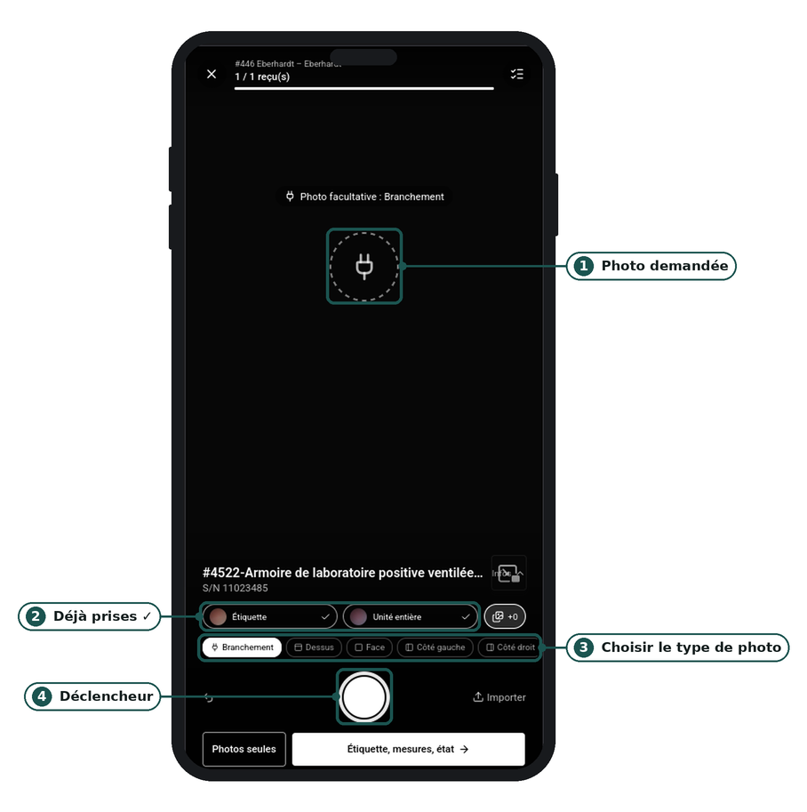
*Image 9 — ① Photo demandée · ② Déjà prises ✓ · ③ Choisir le type de photo · ④ Déclencheur. (Ancienne interface.)*

> 💡 Prenez ce qui est utile pour l'appareil : l'intérieur d'un frigo oui,
> celui d'une pipette non. La plaque arrière aide souvent à trouver la
> référence.

### 5.4 Passer à la suite

Touchez **Suivant : n° de série →** (bouton blanc en bas). Attendez la fin de
« Enregistrement… » si une photo est encore en cours d'envoi.

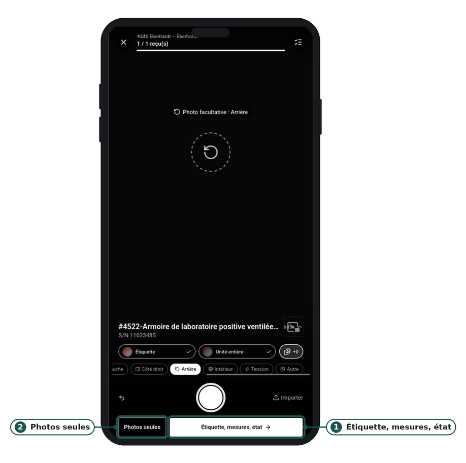
*Image 10 — ① Étiquette, mesures, état · ② Photos seules. (Ancienne
interface : un seul bouton maintenant, « Suivant : n° de série ».)*

### Les autres boutons de la caméra

| Bouton | Rôle |
|---|---|
| **⬆ Importer** | Choisir une photo déjà prise (galerie, ordinateur) au lieu de photographier. |
| **Étiquette** / **Produit entier** | Reprendre cette photo (« · reprendre » une fois prise). |
| **✕ (en haut à gauche)** | Revenir à la liste des produits. |

---

## 6. Compléter le produit, étape par étape

Après les photos, chaque étape s'ouvre l'une après l'autre. En haut :
**le nom du produit**, le compteur **3/5** et les **5 étapes** (Photos,
N° de série, Variante, Mesures, État) : elles se cochent ✓ quand elles sont
faites, et on peut en rouvrir une en la touchant pour corriger.

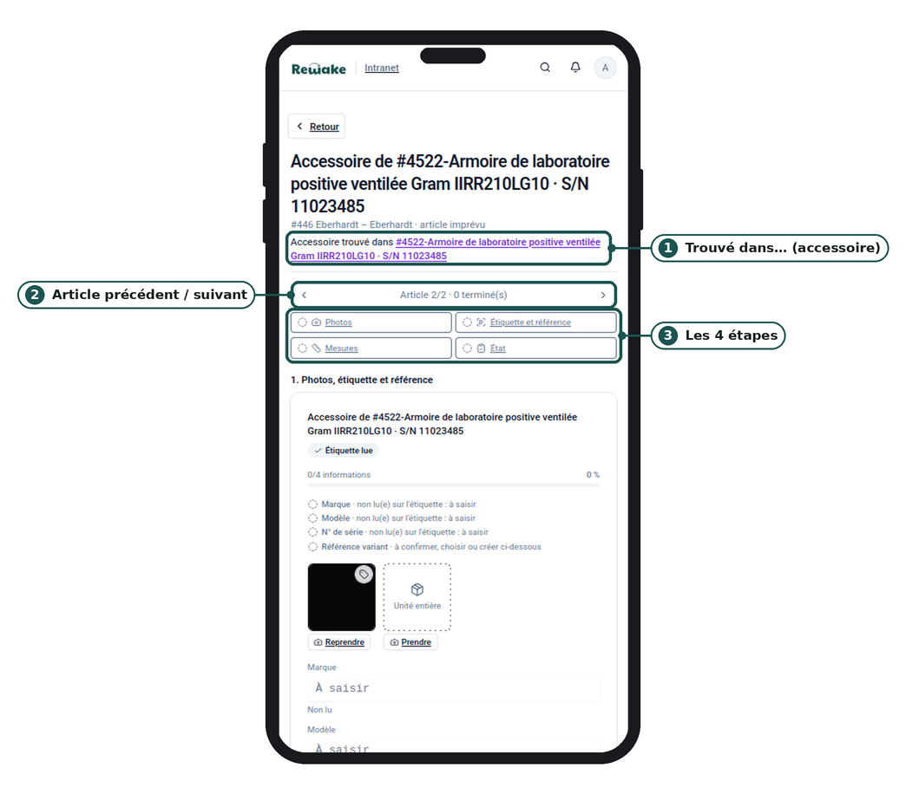
*Image 11 — ① Trouvé dans… (accessoire) · ② Article précédent / suivant · ③ Les 4 étapes. (Ancienne interface.)*

### 6.1 N° de série

Le numéro lu sur l'étiquette est **pré-rempli**. Pendant la lecture,
« Lecture de l'étiquette… » s'affiche (**Saisir sans attendre** pour taper
tout de suite). Sous le champ, une petite ligne dit d'où vient le numéro :

| Mention | Que faire |
|---|---|
| **Lu sur l'étiquette** | Vérifier d'un coup d'œil. |
| **Lu sur l'étiquette (à bien vérifier)** | Comparer avec l'appareil, corriger si besoin. |
| **Lu par l'IA sur les photos** / **Indiqué dans la reprise** | Vérifier sur l'appareil. |
| **✨ L'IA lit : … — Utiliser** | L'IA a lu un autre numéro : comparer, toucher **Utiliser** si c'est juste. |

- **Identique à la reprise.** (vert) : tout va bien. **Différent de la
  reprise** (orange) : vérifiez que c'est le bon produit ; le bouton devient
  **Valider ce numéro quand même**.
- Touchez **Valider le n° de série**. Pas de numéro du tout ? **Ce produit
  n'a pas de n° de série** (noté « NA »).
- Photo illisible ? **Photo floue ? Reprendre l'étiquette**. Si une nouvelle
  photo montre un autre numéro, l'étape est à valider de nouveau.

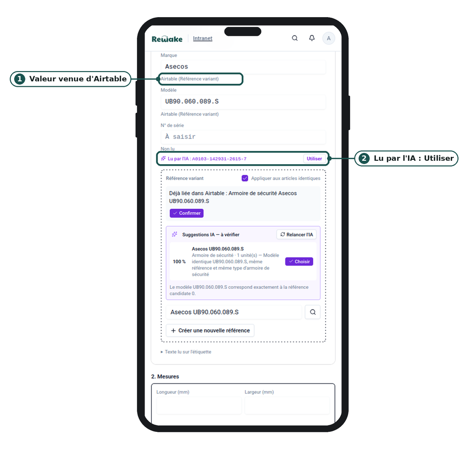
*Image 12 — ① Valeur venue d'Airtable · ② Lu par l'IA : Utiliser. (Ancienne interface.)*

> 💡 Le n° de série est souvent écrit **SN:** ou **S/N** sur l'étiquette.

### 6.2 Marque et modèle (la Référence variant)

C'est l'étape la plus importante : elle relie l'appareil à **sa fiche
Airtable**. La photo de l'étiquette et ce qui y a été lu (« Sur
l'étiquette ») restent affichés pour comparer. Quatre cas :

**Cas A — Déjà reliée dans Airtable** (fréquent pour les reprises)
→ Vérifiez que c'est bien l'appareil, puis touchez **✓ Oui, c'est bien ce
produit** (sinon **Non, ce n'est pas ce produit**).

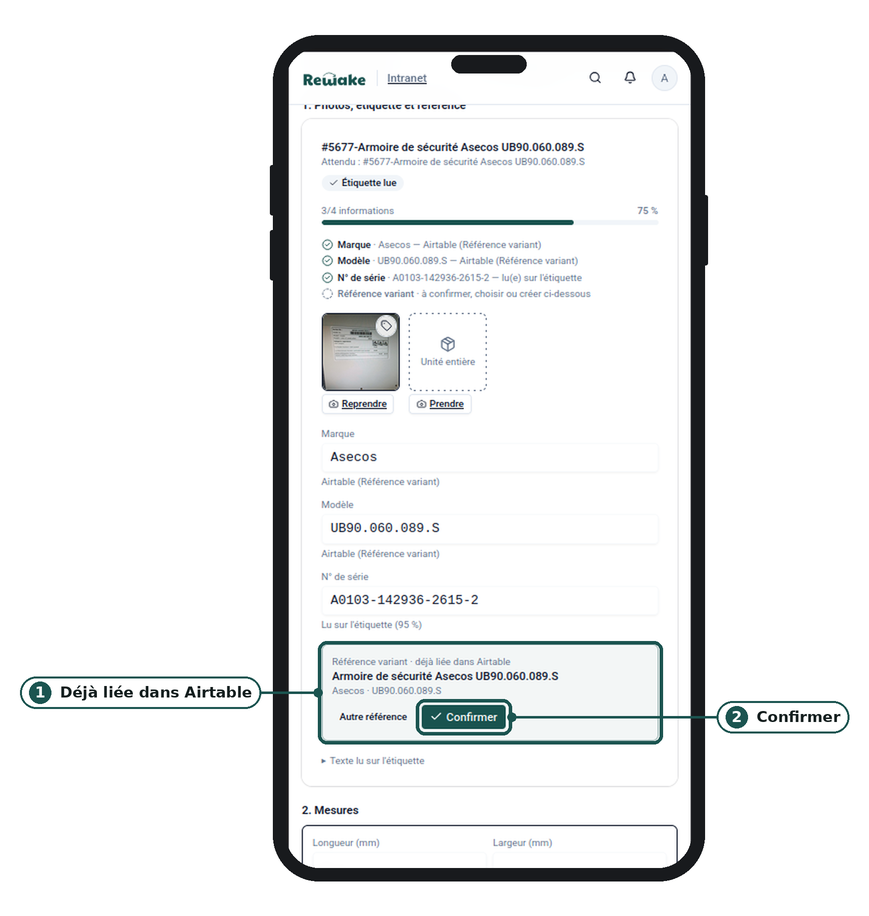
*Image 13 — ① Déjà liée dans Airtable · ② Confirmer. (Ancienne interface.)*

**Cas B — Proposé par l'IA**
→ Pendant « Recherche de la référence… », l'IA lit les photos. Les références
qui **existent dans Airtable** s'affichent avec un **% sûr**. Touchez la bonne
(en général la première), puis **Choisir cette référence**.

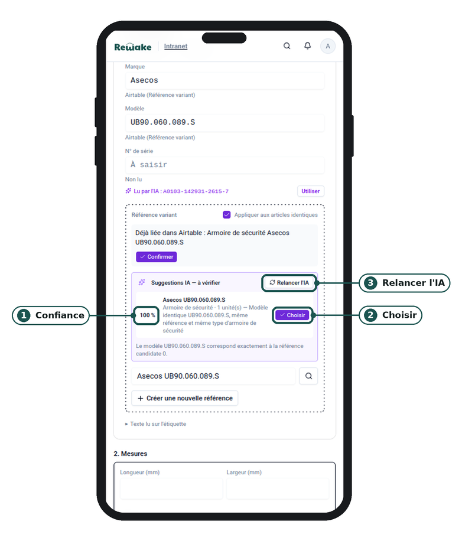
*Image 14 — ① Confiance · ② Choisir · ③ Relancer l'IA. (Ancienne interface.)*

> 💡 **Relancer** redemande une proposition (par exemple après une nouvelle
> photo). L'icône **✨** dit quelle IA a répondu et quand. « Correspondances
> trouvées (sans IA) » : l'IA n'a pas répondu, ce sont des correspondances
> simples.

**Cas C — Chercher soi-même**
→ **Ce n'est pas proposé : chercher dans Airtable**. Tapez un nom, un numéro
ou les deux (ex. « rotor 2424 »), puis touchez la bonne version et **Choisir
cette référence**. **Autre version** crée une nouvelle version d'un modèle
existant.

**Cas D — Créer une nouvelle référence** (seulement si rien ne correspond)
1. **Introuvable : créer une nouvelle référence** (ou touchez la proposition
   orange « Nouvelle référence : sera créée dans Airtable », puis **Vérifier
   puis créer la référence**).
2. Vérifiez **Marque**, **Modèle**, **Type d'équipement** (les choix
   « proposé par l'IA » sont pré-remplis). Une marque ou un type absent
   d'Airtable est marqué « nouveau dans Airtable » et demande une
   confirmation : vérifiez l'orthographe !
3. **Ajouter une variante** : seulement si le modèle existe en plusieurs
   versions (volume, tension…).
4. Accessoire ? Cochez **C'est un accessoire** et choisissez les modèles
   avec lesquels il est compatible.
5. Relisez « Sera créé dans Airtable », puis **Créer dans Airtable**.

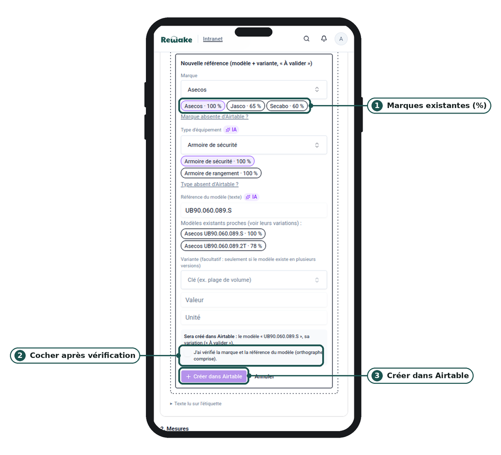
*Image 15 — ① Marques existantes (%) · ② Cocher après vérification · ③ Créer dans Airtable. (Ancienne interface : il n'y a plus de case à cocher.)*

> ⚠️ Ne créez pas de doublon : si l'application signale que le modèle
> **existe déjà dans Airtable**, touchez **Utiliser …** plutôt que d'en créer
> un nouveau.

> ℹ️ La nouvelle référence est créée « À valider » ; le commercial vérifie
> ensuite sa fiche dans l'outil **Revue des produits** (cela ne bloque pas la
> réception).

> 💡 La référence choisie est reportée **toute seule** sur les produits
> identiques (même marque et même modèle) de la réception.

### 6.3 Mesures 📏

| Champ | Obligatoire ? |
|---|---|
| **Longueur, Largeur, Hauteur** (mm) | Oui |
| **Poids** (kg) | Non, facultatif |

- Valeurs en **violet pointillé « connu (Airtable) »** : ce sont les
  dimensions de la fiche. Mesurez rapidement pour vérifier, puis touchez
  **Confirmer les valeurs connues** (ou corrigez le champ).
- **Entrée** sur le clavier passe au champ suivant.
- Appareil impossible à mesurer ? Activez **Mesure impossible**.
- Touchez **Valider les mesures**.

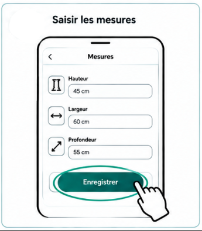
*🖼️ Image 16 — Les 4 champs de mesure, deux en violet « connu
(Airtable) », bouton « Confirmer les valeurs connues », bouton « Valider les
mesures » en bas.*

### 6.4 État 📋

Une réponse par question, en touchant un gros bouton : **Aspect
(esthétique)** et **Fonctionnement**. Par défaut, « Bon » et « Non testé »
sont présélectionnés (« · par défaut ») : changez-les si besoin. Ajoutez un
**commentaire atelier** si utile (défaut, rayure, pièce manquante…), puis
**Valider l'état**.

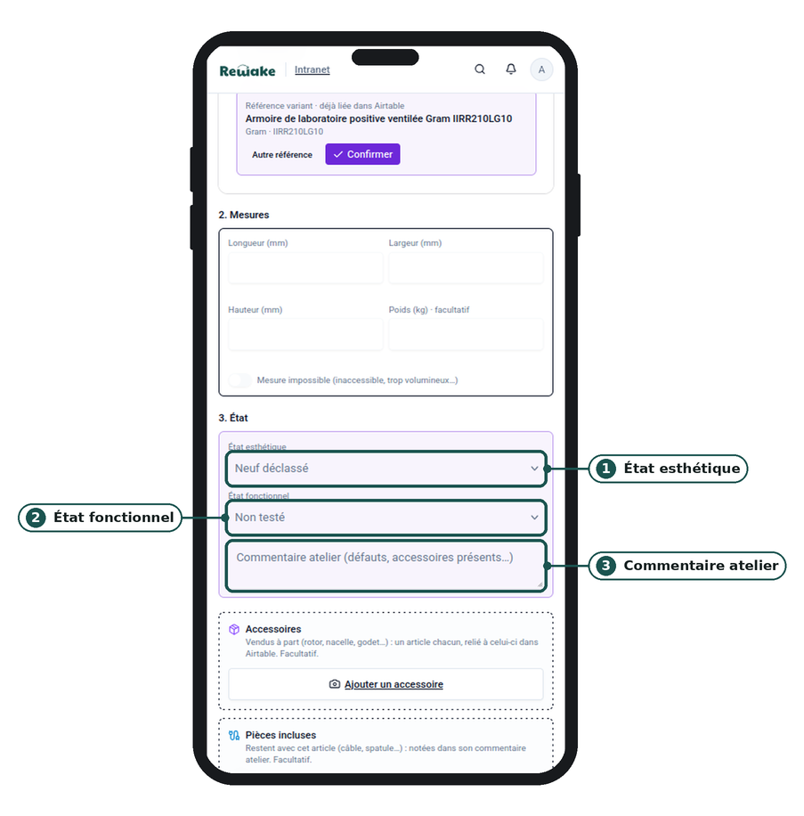
*Image 17 — ① État esthétique · ② État fonctionnel · ③ Commentaire atelier. (Ancienne interface.)*

### 6.5 Accessoires et pièces incluses (facultatif)

**La plupart des produits n'en ont pas** : ignorez ce paragraphe dans ce cas.

| Quoi | Exemples | Où l'ajouter |
|---|---|---|
| **🧩 Accessoire** | rotor, nacelle, adaptateur, godet | Un **produit à part** (vendu séparément), avec ses propres photos, n° de série, référence, mesures, état. |
| **🔌 Pièce incluse** | câble, spatule, plaque de calibration | Juste un **nom**, noté sur ce produit (dans le commentaire atelier envoyé à Airtable). |

**Ajouter un accessoire :** dans la liste des produits, touchez **＋ Ajouter
un produit imprévu** → **Un accessoire** → choisissez le produit avec lequel
il a été trouvé (« Avec quel produit ? »). La caméra s'ouvre : faites-le
comme un produit normal.

**Ajouter une pièce incluse :** à l'étape **État**, encadré **Pièces
incluses**, tapez le nom puis **Ajouter**.

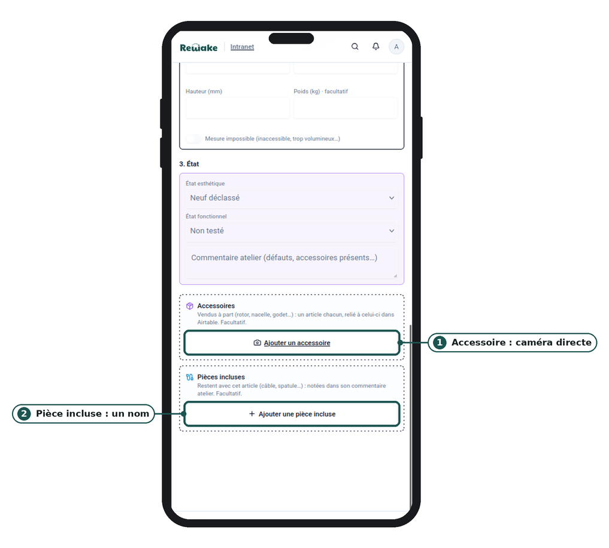
*Image 18 — ① Accessoire : caméra directe · ② Pièce incluse : un nom. (Ancienne interface.)*

> ℹ️ Le lien « cet accessoire va avec cet appareil » est ajouté **tout seul**
> dans Airtable (table Compatibilité) dès que les deux ont leur référence.

---

## 7. Produit complet → produit suivant

Quand les 5 étapes sont faites, l'écran **Produit complet** s'affiche avec
le résumé de chaque étape (touchez une étape pour la modifier, ou **Photos**
pour reprendre une photo).

- Touchez **Produit suivant : …** pour enchaîner, ou **Retour à la liste**.
- Le produit est **envoyé tout seul dans Airtable** : son unité est créée (ou,
  pour une unité de la reprise, complétée) avec la référence, le n° de série,
  les états, le commentaire atelier et **toutes les photos** (« Photos
  interne »). Dans la liste, il affiche **Envoi dans Airtable…** puis **Dans
  Airtable** (lien vers l'unité). Une modification faite ensuite est renvoyée
  automatiquement.
- **« Pas encore dans Airtable » · Réessayer** : l'envoi a échoué (réseau,
  Airtable) ; touchez **Réessayer**. **« Modifié dans Airtable
  entre-temps »** : quelqu'un a changé l'unité dans Airtable ; **Remplacer par
  la réception** remet les valeurs de la réception.

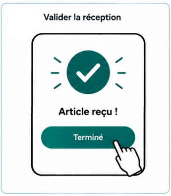
*🖼️ Image 19 — Écran « Produit complet » : coche verte, les 5 étapes
résumées, boutons « Produit suivant : … » et « Retour à la liste ».*

> 🔁 Et on recommence : photos → n° de série → marque et modèle → mesures →
> état.

---

## 8. Reprendre une réception plus tard

Pause, fin de journée, autre urgence ? **Rien n'est perdu** (photos, valeurs,
suggestions sont enregistrées ; recharger la page ne perd rien).

1. Ouvrez **📦 Réception produits**.
2. Onglet **▶ En cours** : touchez **Reprendre**. Vous arrivez directement
   sur le prochain produit à faire.

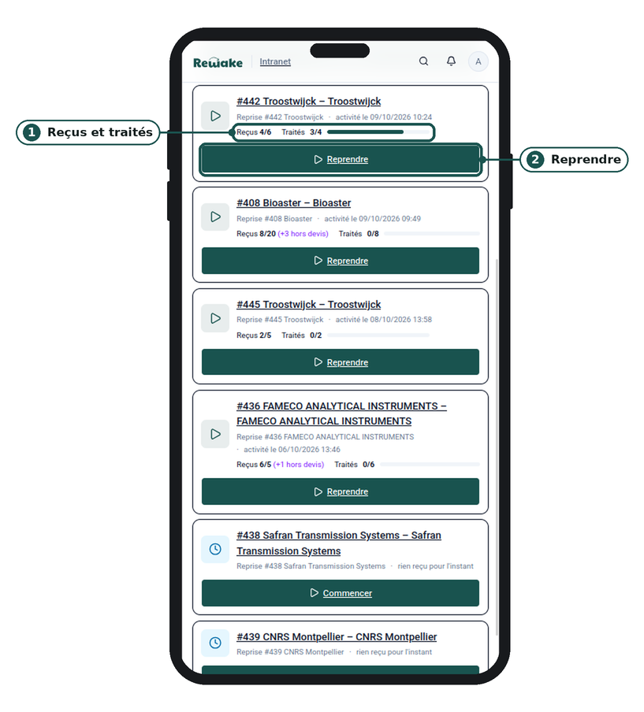
*Image 20 — ① Reçus et traités · ② Reprendre.*

- **Reçus 5/8** : 5 produits reçus sur 8 attendus (« +1 hors devis » si un
  produit imprévu a été ajouté).
- **Traités 3/5** : 3 produits complets sur les 5 reçus.

---

## 9. La liste des produits de la réception

La page de la réception (✕ depuis un produit, ou le nom de la réception dans
l'accueil) montre tous les produits, avec en haut **x/y produit(s)
complet(s)** et le pourcentage d'avancement.

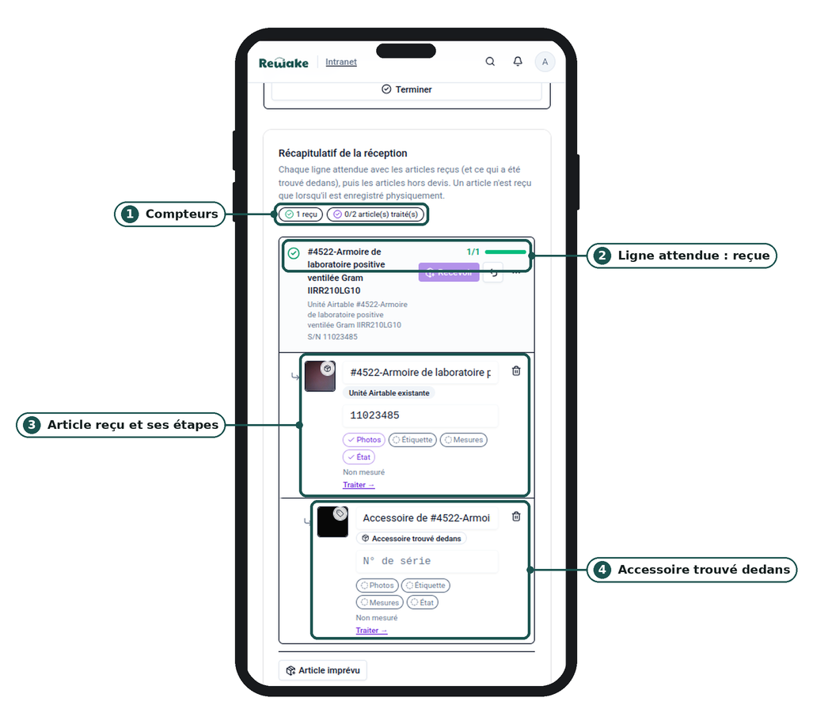
*Image 21 — ① Compteurs · ② Ligne attendue : reçue · ③ Article reçu et ses étapes · ④ Accessoire trouvé dedans. (Ancienne interface.)*

Chaque ligne montre la photo du produit (et la vignette **client** : les
photos envoyées par le client, à toucher pour agrandir), son nom, ses
5 étapes en petites icônes et son état dans Airtable. Touchez une ligne pour
ouvrir le produit.

| Sur la ligne | Signification |
|---|---|
| **À recevoir · touchez pour photographier** | Attendu, pas encore reçu. |
| ✓ vert, bord vert | Produit complet. |
| **Imprévu** (violet) | Pas sur la reprise, ajouté à la main. |
| 🧩 violet | Accessoire (trouvé dans un autre produit) ; « 🧩 2 » : 2 accessoires trouvés dedans. |
| **Non reçu : absent de la livraison** (grisé) | Marqué « pas dans la livraison ». |

**Menu ⋮ d'une ligne :**

- **Pas dans la livraison** : le produit attendu n'est jamais arrivé
  (**Finalement reçu** pour revenir en arrière).
- **Annuler la réception** : produit reçu par erreur (ses photos et
  informations sont retirées ; ce qui avait été envoyé dans Airtable est
  défait).
- **Renommer** / **Retirer ce produit** : pour un produit imprévu.

**＋ Ajouter un produit imprévu** : **Un produit** (une machine, un appareil
qui n'était pas prévu) ou **Un accessoire** (voir [§ 6.5](#65-accessoires-et-pièces-incluses-facultatif)).

---

## 10. Terminer la réception

Quand **tous les produits sont complets** (« Tous les produits sont
complets. »), touchez **✓ Terminer la réception** en bas de la liste, puis
**Terminer**.

- S'il reste des produits incomplets ou non reçus, la fenêtre les liste avec
  ce qui manque : **Compléter d'abord**, ou **Terminer quand même** (les
  produits incomplets n'iront dans Airtable qu'une fois terminés).
- La réception est **terminée** tout de suite : elle passe dans
  l'**Historique**. Les produits complets sont déjà dans Airtable : il n'y a
  pas d'autre étape. Besoin de corriger ? Ouvrez-la et touchez **Rouvrir**.

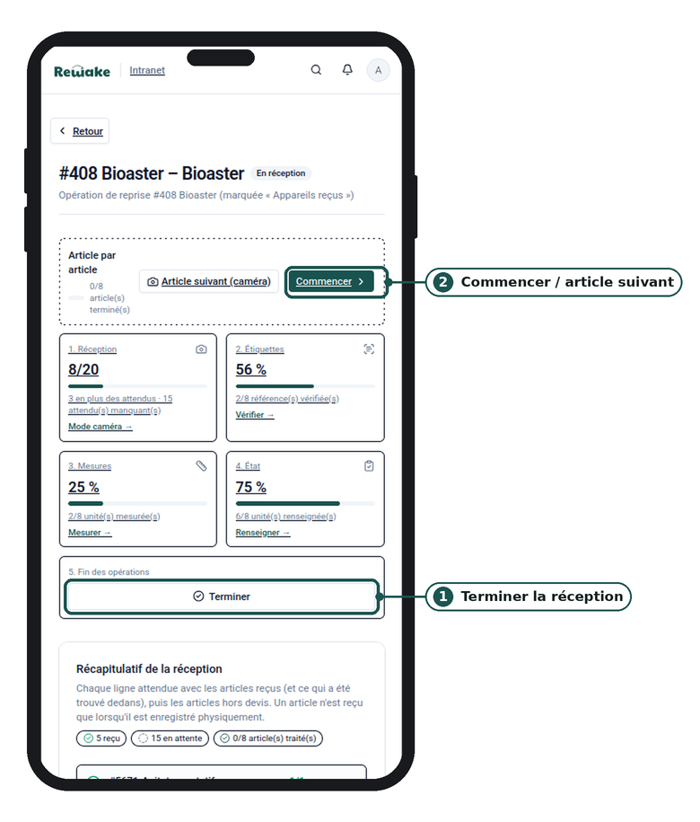
*Image 22 — ① Terminer la réception · ② Commencer / article suivant. (Ancienne interface.)*

---

## 11. Astuces

- 📷 **Étiquette nette = moins de saisie.** Approchez-vous, évitez les
  reflets (inclinez légèrement le téléphone), essuyez l'étiquette si besoin.
- 🔢 Le n° de série est presque toujours après **SN:** ou **S/N**.
- 🏷️ Pas d'étiquette ? **Sans étiquette**, puis tapez le n° de série et
  cherchez la référence à la main.
- 🖼️ Une photo déjà prise ? **Importer** dans la caméra.
- 🔄 Une photo ratée ? Écran **Produit complet** → **Photos** → touchez la
  photo : la caméra s'ouvre pour cette photo seulement.
- ✨ Proposition bizarre ? Reprenez l'étiquette, puis **Relancer**.
- 👯 Plusieurs appareils identiques ? La référence choisie pour l'un est
  reportée sur les autres.
- 🔁 Recharger la page ne perd rien.
- 📶 Réseau lent ? Attendez la fin de la barre de chargement en haut avant de
  toucher à nouveau.

---

## 12. Problèmes fréquents

| Problème | Solution |
|---|---|
| « Caméra non disponible ici » / « Accès à la caméra refusé » / « Caméra indisponible » | Autorisez la caméra dans les réglages du navigateur, vérifiez l'adresse en **https**, touchez **Réessayer**, ou **Importer une photo**. |
| « Lecture de l'étiquette… » ne finit pas | **Saisir sans attendre**, ou **Photo floue ? Reprendre l'étiquette**. |
| Le n° de série n'est pas trouvé | Regardez la ligne « L'IA lit : … Utiliser », sinon tapez-le. |
| « Proposition indisponible » | **Réessayer**, ou **Ce n'est pas proposé : chercher dans Airtable**. |
| Aucune référence proposée ne correspond | **Chercher dans Airtable**, puis seulement si rien n'existe : **créer une nouvelle référence**. |
| Produit reçu par erreur | Liste → **⋮ → Annuler la réception**. |
| Un produit attendu n'est jamais arrivé | Liste → **⋮ → Pas dans la livraison**. |
| Une étape est fausse | Touchez l'étape en haut de l'écran du produit et corrigez. |
| La reprise n'est pas dans « À réceptionner » | Dans Airtable, Statut logistique **« Appareils reçus »** ; une reprise dont la réception est terminée n'y est plus (voir **Historique**). |
| « Listes d'états indisponibles » | Airtable injoignable : réessayez plus tard. |
| « Reprises Airtable indisponibles » | Problème de connexion avec Airtable : réessayez dans quelques minutes, prévenez l'équipe technique si cela dure. |

---

## 13. Légende des icônes et couleurs

**Types de photo** (en haut à droite des vignettes et dans la caméra)

| Icône | Type |
|---|---|
| 🏷️ étiquette | Étiquette |
| 📦 boîte | Unité entière (produit entier) |
| 🔌 prise | Branchement |
| ▭ panneau haut | Dessus |
| ▢ carré | Face |
| ▯ panneau gauche / droit | Côté gauche / droit |
| ↺ flèche | Arrière |
| 📭 boîte ouverte | Intérieur |
| ⚡ éclair | Tension |
| 🖼️ image | Autre |

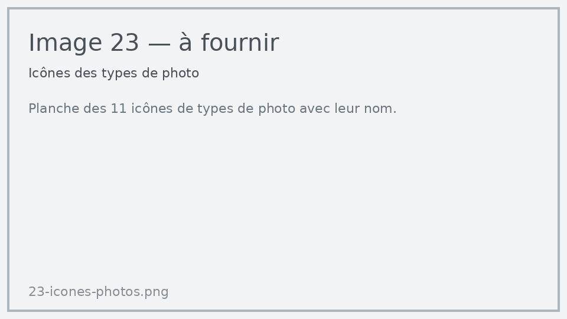
*🖼️ Image 23 — Planche des 11 icônes de types de photo avec leur nom.*

**Étapes d'un produit** : 📷 Photos · 🔢 N° de série · 🗂️ Variante (marque et
modèle) · 📏 Mesures · 📋 État. Pleine = faite, vide = à faire.

**Accueil**

| Couleur | Signification |
|---|---|
| 🔵 bleu ▶ | En cours |
| 🩵 bleu clair 🕓 | Ouverte, rien reçu |
| 🟠 orange 🚚 | Reprise à réceptionner |
| 🟢 vert ✓ | Terminée |
| ⚪ gris | Annulée |
