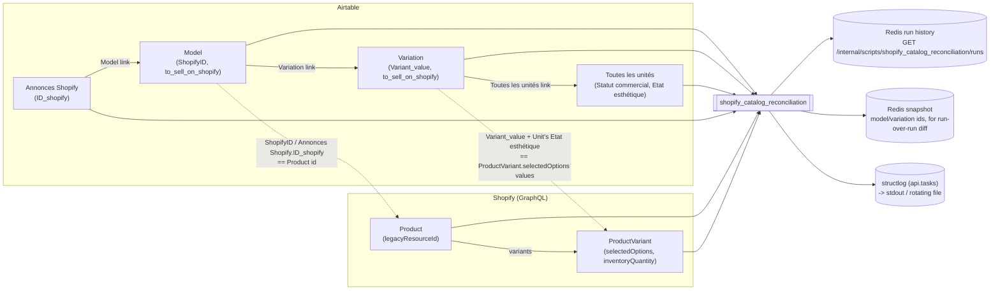

# Shopify Catalog Reconciliation

 

| | |
| --- | --- |
| **Module** | `api.scripts.shopify_catalog_reconciliation` |
| **Schedule** | every hour (`SHOPIFY_CATALOG_RECONCILIATION_INTERVAL_SECONDS`, default `3600`) -- also runnable on demand |
| **Reads** | Airtable (Model, Variation, Toutes les unités, Annonces Shopify) + Shopify (Products, Variants) |
| **Writes** | nothing -- strictly read-only |
| **Requires** | Airtable (`AIRTABLE_BASE_ID`, `AIRTABLE_TOKEN`) + Shopify (`SHOPIFY_SHOP_DOMAIN`, `SHOPIFY_CLIENT_ID`, `SHOPIFY_CLIENT_SECRET`) settings, otherwise the run is recorded as `skipped` |

## What it does

Verifies that Shopify actually reflects what Airtable says should be sellable, in three
checks, from broad to specific:

1. **Every relevant Model exists as a Shopify product.**
2. **Every relevant Variation of a Model found in Shopify exists as a Shopify variant.**
3. **Every "A vendre" unit's Shopify variant has the right inventory quantity.**

"Relevant" always means: flagged `to_sell_on_shopify` **and** currently has at least one
unit in stock (`Statut commercial = "A vendre"`). A Model or Variation that's the *kind*
of thing sold online but has zero stock right now is correctly absent from Shopify --
it is never flagged as "missing". Units in an excluded condition (`EXCLUDED_CONDITIONS`:
"Abimé", "Très abimé", compared ignoring accents and case) are never put on Shopify by
`create_product_shopify`/`update_product`, so they don't count as stock here either.

It also reports catalog integrity problems, outside those three checks:

- **Prices at 0** on either side. These are A vendre units expected on Shopify whose
  `Prix de vente HT` is 0, empty or invalid; `create_product_shopify` and
  `update_product` refuse to run on such a Model. It also reports Shopify variants
  priced at 0 that Airtable still has A vendre units for (same Variation and
  condition), on a product that isn't archived, since those are meant to be sold. A
  0 € variant with no A vendre stock in Airtable is correct: the sales team sets the
  price to 0 when stock runs out.
- **Duplicates and orphans**, which break "one Model = one Annonces Shopify = one
  Shopify product":
  - Shopify products with the same title, e.g. a creation that ran twice. Each copy
    shows which Model it belongs to, or none. Different products can share a name,
    so a group is only reported when a copy belongs to no Model or two copies belong
    to the same Model. Same-title products that each have their own Model and
    Annonces Shopify are correct.
  - Shopify products that no Annonces Shopify record and no Model refers to, except
    drafts (being prepared, not orderable yet). This one is **informational, not an
    error**: some products legitimately exist only on Shopify, and the dashboard lists
    them (neutral style, low priority) so they can be identified.
  - Models linked to more than one Annonces Shopify record.
  - Shopify ids used by more than one Annonces Shopify record.
  - Units not yet sold whose Variation(s) lead to more than one listing, for example
    through a Model with two listings, or a unit linked to Variations of two Models.

These are reports only: the run stays `success`, and the script still changes nothing.

## Why the matching is value-based, not ID-based

Airtable's `Variation.ShopifyID` field is **not a real variant id** -- confirmed against
production data, it always duplicates the parent Model's own product id, even across
Variations that are genuinely different Shopify variants. There is no Airtable field
holding a real Shopify variant id at all.

Instead, a Shopify variant is identified by its `selectedOptions` **values** (the option
*names* vary per product type -- a pipette's size option isn't named the same as a
fridge's -- so matching is name-agnostic, value-only). Those literal value strings
match Airtable, once both sides are whitespace-normalized:

- a Variation's own `Variant_value` (a size/range, e.g. `"5 - 50"`), plus
- a Unit's own `Etat esthétique` (condition, e.g. `"Très bon"`)

...together pin down exactly one Shopify variant. So **one Airtable Variation
corresponds to one Shopify variant *per condition it currently has stock in***, not a
single variant -- and a unit that's "A vendre" through a different channel entirely
(eBay, an auction, direct sale) is never expected on Shopify in the first place, so it's
excluded from all three checks.

This was two real, confirmed production bugs (ID-based matching finding 100% of
variations "missing"; then a scoping bug over-flagging units sold through other
channels) before this design -- and a third since: `Variant_value` is manually-entered
free text and can carry incidental whitespace (a real `"150x75 "` in Airtable) that
Shopify itself trims on save (`"150x75"`); comparing the raw, un-normalized values meant
a genuinely-existing variant was reported as missing. Both `Variation.variant_values`
(`api/domain/catalog.py`) and `ShopifyVariant.option_values`
(`api/integrations/shopify.py`) now strip before comparing -- the exact same class of
bug independently found and fixed in `update_product.py`'s own (separate) variant
matching, see `docs/update_product.md`.

## Data it fetches

## How it works

1. Fetch Models, Variations, Units, and Annonces Shopify listings from Airtable
   (`api.domain.catalog`, built on this project's own `api.services.airtable`
   functions).
2. Fetch every Shopify Product and its Variants in one paginated GraphQL sweep
   (`api.integrations.shopify.ShopifyCatalog`).
3. Resolve each Model's Shopify product: prefer the linked Annonces Shopify listing's
   `ID_shopify`, fall back to the Model's own `ShopifyID`, then to a product tagged
   `airtable-model-<Model record id>` (only the dev-store seeding script sets that tag,
   since dev-store product ids never match Airtable's production ids -- a no-op in
   production).
4. **Check 1:** for every Model that's `to_sell_on_shopify` and has current stock, is its
   resolved product id actually one of the fetched Shopify products?
5. **Check 2:** for every Variation of a *found* Model that's `to_sell_on_shopify` and has
   current stock, does that product have any variant whose option values are a superset
   of the Variation's `Variant_value`?
6. **Check 3:** group "A vendre" units (in a listable condition) of Shopify-bound
   Variations by `(Variation, Etat esthétique)` -- a unit with no condition is counted
   in `a_vendre_units_total` but can't be matched to a variant. For each group, does a variant exist whose option
   values are a superset of `{Variant_value, condition}`? If not, that's a missing
   variant; if it exists but its `inventoryQuantity` doesn't match the unit count,
   that's a quantity mismatch.
7. Diff the current full set of Model/Variation ids against the previous run's snapshot
   (stored in Redis, via `api.run_store.RunStore`) to report how many were added since
   last time (0 on the very first run).
8. Enrich `details` (best-effort, never fails the run): Airtable record urls, then the
   latest `create_product_shopify`/`update_product` attempts (see below).

Live stages (`GET /internal/scripts/shopify_catalog_reconciliation/current`):
`fetching_airtable_models`, `fetching_airtable_variations`, `fetching_airtable_units`,
`fetching_airtable_shopify_listings`, `fetching_shopify_products`, `comparing_catalogs`,
`attaching_airtable_urls`, `attaching_creation_attempts`.

## Metrics and details

`GET /internal/scripts/shopify_catalog_reconciliation/runs` returns, per run:

| Metric | Meaning |
| --- | --- |
| `relevant_models_total` | Models that are `to_sell_on_shopify` and currently in stock |
| `models_missing_in_shopify` | ...of those, how many have no matching Shopify product |
| `relevant_variations_total` | Variations of a *found* Model that are `to_sell_on_shopify` and in stock |
| `variations_missing_in_shopify` | ...of those, how many have no matching Shopify variant (any condition) |
| `a_vendre_units_total` | Shopify-bound "A vendre" units (excludes other sales channels) |
| `a_vendre_units_missing_variant` | (Variation, condition) pairs with stock but no matching Shopify variant at all |
| `a_vendre_quantity_mismatches` | (Variation, condition) pairs where the variant exists but its quantity is wrong |
| `documentation_missing_in_airtable` | Relevant Models (on Shopify yet or not) with no PDF at all in their Airtable `Documentation` field -- the list of documentation still to collect |
| `documentation_missing_in_shopify` | Found Models with a `Documentation` PDF in Airtable but no "PDF Descriptif" on Shopify |
| `documentation_outdated_in_shopify` | Found Models whose Shopify PDF wasn't uploaded from Airtable's current attachment (replaced in Airtable, or set by hand -- see `docs/update_product.md`) |
| `a_vendre_units_without_price` | Units expected on Shopify (A vendre, listable condition, Shopify-bound Variation) with a `Prix de vente HT` of 0, empty or invalid |
| `shopify_variants_without_price` | Variants priced at 0 that Airtable has A vendre stock for, on a Shopify product that isn't archived |
| `duplicate_shopify_products` | Groups of Shopify products with the same title (case and spacing ignored) where a copy has no Airtable Model or two copies share one; each copy with its Model or `null` |
| `shopify_products_not_in_airtable` | Non-draft Shopify products no Annonces Shopify record, Model `ShopifyID` or dev-store tag refers to |
| `models_with_multiple_shopify_listings` | Models linked to more than one Annonces Shopify record |
| `shopify_ids_with_multiple_listings` | Shopify product ids used by more than one Annonces Shopify record |
| `units_with_multiple_shopify_listings` | Units not sold yet that reach more than one Annonces Shopify record through their Variation(s) |
| `models_added_since_last_run` / `variations_added_since_last_run` | Catalog growth since the previous run |
| `succeeded` | Always `1` on a completed run |

`details` in the same response carries the actual named records behind each count above
(model/variation id + name + an Airtable web-UI link via `record_url`), uncapped -- the
frontend acts on these lists directly (a per-model "create on Shopify" button, and one
that bulk-creates every missing model), so silently dropping entries past some cap would
mean those specific models could never be created via the dashboard at all, not just a
display inconvenience.

`attach_creation_attempts` (called from `run()`, right after `attach_airtable_urls`) then
cross-references each `models_missing_in_shopify` entry against
`create_product_shopify`'s own run history (via `RunStore`, ~1000 runs kept -- see
`docs/architecture.rst`), and adds `entry["last_creation_attempt"]` (`status`, `error`,
`skipped_reason`, `finished_at`) when that Model has already been attempted. A Model
showing up as "missing" isn't necessarily untried -- it might already be failing for a
knowable reason (bad Airtable data, a stale Shopify desync, an image upload conflict),
and that's a very different situation from "nobody has tried creating it yet". This is
a read-only lookup against Redis (a second script's stored history, not a mutation of
anything) and, like `attach_airtable_urls`, is wrapped so it can never fail the
reconciliation run itself -- a broken/unreachable RunStore just means no entry gets
`last_creation_attempt`, not a failed run.

`attach_update_attempts` does the same for `variations_missing_in_shopify`: each entry
gets `last_update_attempt` (`status`, `error`, `finished_at`) from the latest
`update_product` run whose `details.record_id` is that Variation. Runs triggered with
`model_id` have no `record_id`, so they aren't attributed to individual Variations.

The documentation lists only cover *relevant* Models that were found on Shopify (a Model
missing from Shopify entirely is already `models_missing_in_shopify`). The Shopify side
comes from the same bulk GraphQL read (two aliased `metafield(...)` fields per product).
`attach_documentation_attempts` adds `last_update_attempt` to the missing/outdated
entries from `update_product`'s history, matched by `details.model_id`. It only counts
runs that actually tried a documentation sync (a failure, a skip, or a success with
`documentation_status: "uploaded"`). The dashboard's "Envoyer toutes les documentations
manquantes" / "Remplacer toutes les documentations obsolètes" buttons fan out
`update_product?model_id=...` over those lists, 3 at a time. A run counts as updated
only when it actually uploaded a PDF.

The Shopify-side entries (`shopify_variants_without_price`,
`duplicate_shopify_products`, `shopify_products_not_in_airtable`, and the `product`
of `shopify_ids_with_multiple_listings`) carry the product's Shopify admin `url`. The
Airtable-side ones get the record's `url` from `attach_airtable_urls`, and every
listing in a `listings` list gets the Annonces Shopify record's `url`. The title
comparison runs against the whole Shopify catalog; same-title products that each
belong to a different Model are not reported.

## Where to look

- **Trigger/history:** `GET /internal/scripts/` (confirm it's registered), `POST
  /internal/scripts/shopify_catalog_reconciliation/run` (run it now), `GET
  /internal/scripts/status/{task_id}` (poll one run), `GET
  /internal/scripts/shopify_catalog_reconciliation/runs` (history), `GET
  /internal/scripts/shopify_catalog_reconciliation/current` (live stage).
- **Schedule:** `api/celery_app.py`'s `beat_schedule`, driven by the `beat` service in
  `docker-compose.yml`.
- **Logs:** `structlog`, logger `api.tasks` (stdout, or the rotating file at
  `api/constants.py`'s `LOG_FILE`).
- **Dashboards/alerting:** `GET /metrics` (`api/routes/metrics.py`) exposes this run's
  metrics as `rewake_api_script_metric{script="shopify_catalog_reconciliation", ...}`
  for Prometheus; RewakeObserve's Grafana dashboards query that series directly.
- **Source:** `api/scripts/shopify_catalog_reconciliation.py`, `api/domain/catalog.py`,
  `api/integrations/shopify.py`.
- **Tests:** `tests/test_shopify_catalog_reconciliation.py`.
